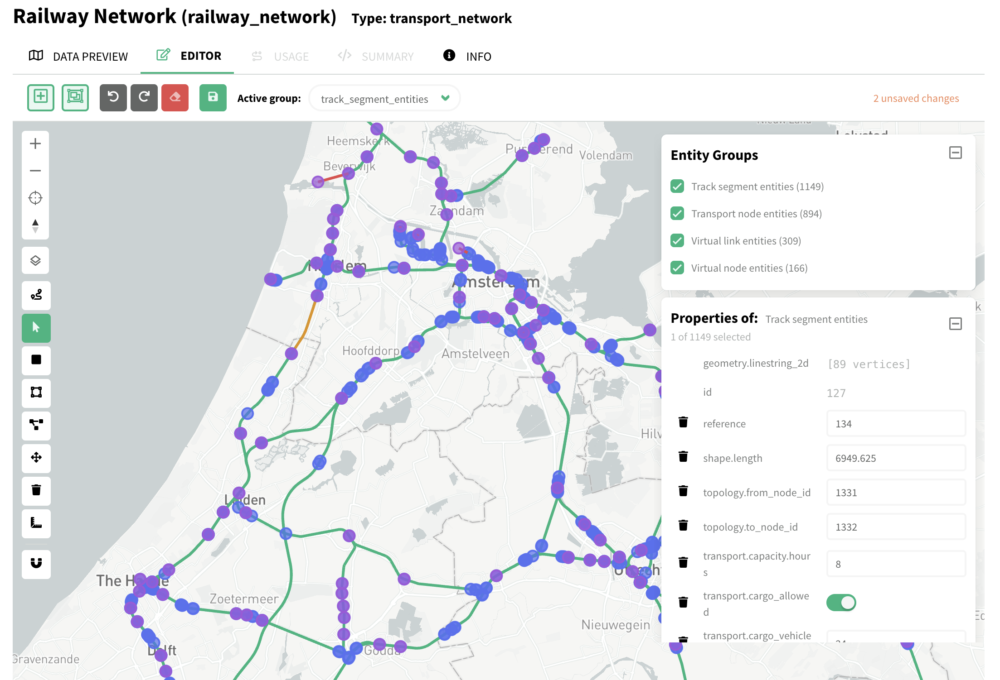
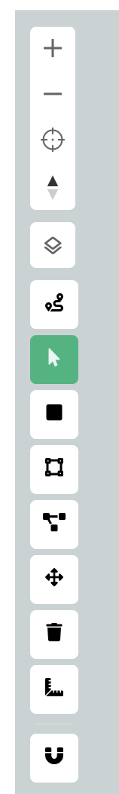
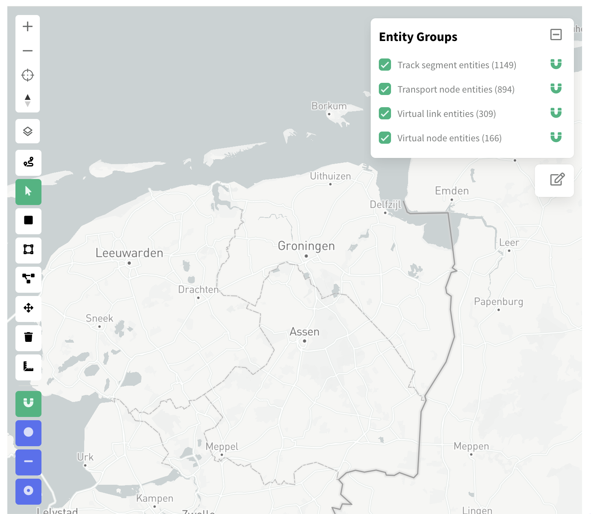
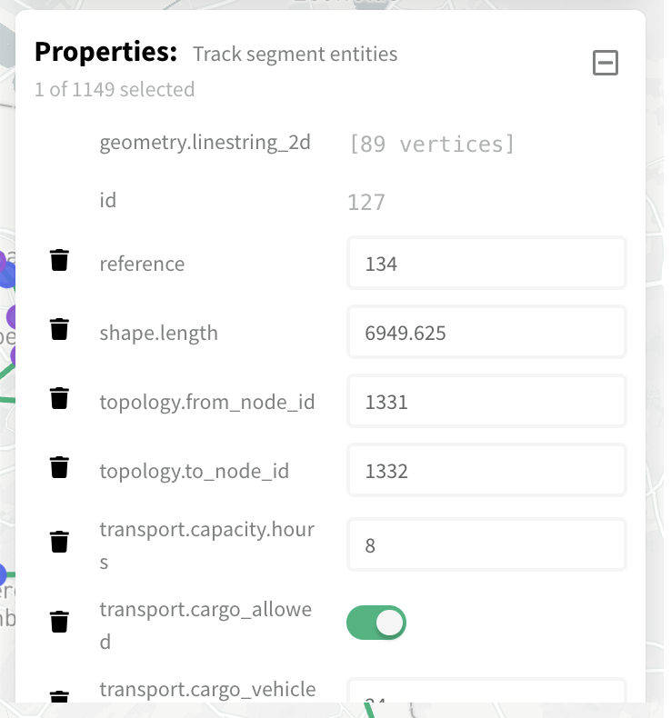

# Dataset Editor

This component enables editing datasets given the backend provides the right capabilities. The main features of the dataset editor are:

- Editing 2D geometry of entities: draw point, lines and polygons, modify vertices, move geometries, and delete geometries.
- Editing properties of single entities and a selected multiple entities (batch editing).
- Entity selection: single selection, selection by rectangle, selection by area (spatial selection).
- One-click measuring tool for lines's length and polygon's perimeter and area.
- Spatial snapping that can target vertices, segments, and endpoints, and can be controlled per entity group.
- Tool for adding attributes to entity groups.
- Tool for adding entity groups to datasets.
- Undo, redo, and save buttons.

## Required Capabilities

The dataset editor requires the backend to expose a `DatasetPatch` capability through the `DatasetService`, as defined in [backend.ts](src/types/backend.ts)

The backend should provide an API endpoint that supports the following operations and behaviour.

| Operation                              | Behaviour                                                                                                                                                      | Conditions                                                                                                                                                                                      | Payload Example                                                                            |
| -------------------------------------- | -------------------------------------------------------------------------------------------------------------------------------------------------------------- | ----------------------------------------------------------------------------------------------------------------------------------------------------------------------------------------------- | ------------------------------------------------------------------------------------------ |
| Create **Attributes**               | Create `new_attr` on `some_entities` with values `100` and `200`.                                                                                              | `new_attr` does not exist in `some_entities`.                                                                                                                                                   | `{"data":{"some_entities":{"id":[1,2],"new_attr":[100,200]}}}`                             |
| Create **Entities**                 | Create an entity with attribute `attr` set to `300`. The `-1` ID is a placeholder requesting the client's API to assign an ID.                                 | ---                                                                                                                                                                                             | `{"data":{"some_entities":{"id":[-1],"attr":[300]}}}`                                      |
| Create **Entities (no attributes)** | Create an entity without attribute values. The `-1` ID is a placeholder requesting the client's API to assign an ID.                                           | Backend automatically assigns ID attribute to an entity                                                                                                                                         | `{"data":{"some_entities":{"id":[-1]}}}`                                                   |
| Create **Entity Groups**            | Create the `new_entities` group with three entities and one attribute.                                                                                         | `new_entities` does not exist in the dataset.                                                                                                                                                   | `{"data":{"new_entities":{"id":[1,2,3],"attr":[100,200,300]}}}`                            |
| Update **Single Attribute**         | Update `attr` for entities with IDs `1` and `3` to `10` and `11`, respectively. Leave other IDs (for example, `2`) unchanged.                                  | IDs `1` and `3` already exist and have `attr`                                                                                                                                                   | `{"data":{"some_entities":{"id":[1,3],"attr":[10,11]}}}`                                   |
| Update **Multiple Attributes**      | Update `attr` for ID `1` to `10` and ID `3` to `11`; update `attr2` for ID `2` to `100`. `null` values are holes and leave the corresponding values unchanged. | IDs `1`, `2` and `3` already exist and `some_entities` have `attr` and `attr2` attributes                                                                                                       | `{"data":{"some_entities":{"id":[1,2,3],"attr":[10,null,11],"attr2":[null,"100",null]}}}`  |
| Delete **Entities**                 | Delete entities `1` and `3` from `some_entities`.                                                                                                              | ---                                                                                                                                                                                             | `{"data":{"some_entities":{"id":[1,3],"deleted":[true,true]}}}`                            |
| Delete **Attribute Values**         | Delete values of `attr` by setting them to undefined (`null`) for entities `2` and `3`; set it to `10` for entity `1`.                                         | IDs and attributes exists in `some_entities`. `nulls_overwrite` is set to `true`.                                                                                                               | `{"nulls_overwrite":true,"data":{"some_entities":{"id":[1,2,3],"attr":[10,null,null]}}}`   |
| Delete **Attributes**               | Delete `attr` from `some_entities`. An entity group cannot retain an attribute whose values are all `null`, so the attribute must be dropped.                  | `nulls_overwrite` is `true`; after applying the operation, all values of `attr` for `some_entities` are undefined (`null`).                                                                     | `{"nulls_overwrite":true,"data":{"some_entities":{"id":[1,2,3],"attr":[null,null,null]}}}` |
| Delete **Entity Group**             | Delete the `some_entities` group.                                                                                                                              | After applying the operation, `some_entities` contains zero entities. Entity groups must contain at least one entity; therefore, entity group should be dropped. `deleted: false` is not valid. | `{"data":{"some_entities":{"id":[1,2,3],"deleted":[true,true,true]}}}`                     |

## Editor UI

The UI consists of toolbars, side panels and a map. Tools and options appear active based on
the state of a dataset. The editor support editing a single dataset at the time, but any entity group within such
dataset can be edited.

### Editor Toolbar

The editor toolbar on top of the dataset editor contains generic tools that support editing entities:
`add attribute`, `new entity group`, `undo`, `redo`, `discard changes`, and `save`.
The **Active group** dropdown menu controls to which entity group editing operations would be apply.
To edit entities from a different entity group, such group should be first selected.

When there are unsaved changes, a message is shown on the right of the toolbar.

### Edit Mode Toolbar

Contains tools for editing entities shown on the map. Map control tools enable map selection, zooming, orientation and location.
Edit mode tools enable drawing, selecting, modifying, and deleting geometries. The behaviour and activation of some of these tools
changes depending of the geometry type of the **Active group**.

An utility tool `Measure length/area` can be used to compute the dimensions of geometries by click on them. This tool work for
line segments and polygons.
At the bottom of the _edit mode toolbar_, there is the **snapping** tool.

### Snapping Tools

The snapping tool support editing geometries by automatically sticking the position of new geometries
to existing ones. Once turned on for a dataset, the snapping can be turn on or off per entity group
on the **Entity Groups** panel. Three snapping technique are available:

- **snap to vertex:** snaps to the vertices of a geometry.
- **snap to segment:** snaps to any place along a segment of a line or polygon.
- **snap to endpoint:** snaps to the endpoints of a line segment.

### Property Editor

It enables to manually edit the attribute of selected entities. Attributes can be
edited per entity by selecting such entity and manually changing the values on the
_Property Editor Panel_. Attributes of multiple entities can be changed at once, by
selecting a set of entities with any of the selection tool, and manually assigning a
value in the _Property Editor Panel_. When multiple entities are selected the property
editor shows the message `new value` instead of the actual attribute values. Entering
a new value will assign the same value to all selected entities.

> Some attributes cannot be edited via the Property Editor, for example IDs or geometries.
> Geometries can be edited using the tools on the Edit Mode Toolbar. Other attributes
> can be restricted from editing via the library's configuration.

### Configurations

The following configuration allow to change the behavior of certain components of the
Dataset Editor:

| Configuration                  | Description                                                                                                                      | Location                        |
| ------------------------------ | ------------------------------------------------------------------------------------------------------------------------------- | ------------------------------- |
| `ALWAYS_RESTRICTED_ATTRIBUTES` | Names of attributes that won't be allowed to be edited via the Property Editor                                                  | `src/utils/editorAttributes.ts` |
| `SNAP_TOLERANCE_PX`            | Tolerance for the snapping tool in pixels.                                                                                      | `src/utils/snapping.ts`         |
| `GEOMETRY_COLUMNS`             | List of attribute names in a movici dataset that will be treated as geometries and displayed on the map of the Dataset Editor. | `src/utils/geoJsonBridge.ts`    |
